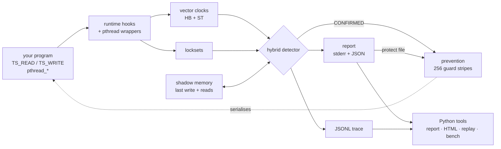

# Thread Sentinel

**Hybrid data-race detection and runtime prevention for POSIX threads, using dual vector clocks and lockset analysis.**

Thread Sentinel is a C11 runtime library for multi-threaded C programs. It watches the shared
accesses you mark, tells you which ones race and how sure it is, and can then serialise exactly
those accesses at runtime so the bug stops happening. No source changes are needed beyond
the markings. It also reports lock-order inversions (potential deadlocks), including in unmodified
binaries via an `LD_PRELOAD` shim.

---

## 1. Why another race detector?

The two classic techniques fail in opposite directions:

| Technique | Idea | Weakness |
|---|---|---|
| **Lockset** (Eraser) | every shared variable must always be protected by some common lock | **false positives** on code ordered without locks: fork/join, barriers, condvar hand-offs |
| **Happens-before** (vector clocks; ThreadSanitizer) | accesses race if neither is causally ordered before the other | **false negatives** when an *unrelated* lock happened to order the accesses on this run |

Thread Sentinel keeps **two vector clocks per thread**: `HB` follows all synchronisation, and `ST`
("structural") follows everything except mutexes. Combined with locksets, this gives three verdicts:

| Verdict | Meaning |
|---|---|
| **CONFIRMED** (high) | not ordered by happens-before and no common lock: the accesses really ran concurrently |
| **POTENTIAL** (medium) | ordered only by luck through an unrelated mutex; another schedule could race |
| SAFE | protected by a common lock, or ordered by fork/join/condvar/barrier |

On the 12 bundled demos, the hybrid detector finds all 7 racy programs with no false positives.
Pure lockset falsely flags 2 safe programs, and pure HB and ThreadSanitizer both miss the
"lucky lock order" race ([evaluation](docs/EVALUATION.md)).

## 2. Architecture



Details: [docs/ARCHITECTURE.md](docs/ARCHITECTURE.md) · rules and a worked example:
[docs/ALGORITHMS.md](docs/ALGORITHMS.md).

## 3. Quick start

Requirements: Linux or WSL2, gcc (C11, pthreads), make, Python 3.10+. Valgrind is optional.

```bash
make setup        # Python venv + requirements (jinja2, plotly, pytest)
make              # libsentinel.a / .so + instrumented demos
make baseline     # uninstrumented (_plain) and ThreadSanitizer (_tsan) demo builds
make test         # C unit tests + pytest integration suite
```

Run a demo:

```bash
PYTHONPATH=tools .venv/bin/python -m sentinel demo 07_lucky_lock_order
```

```
Race #1: [POTENTIAL] (MEDIUM) on x
  Reason: ordered only by luck through unrelated lock, no common lock
  Access 1: WRITE by thread 1 at demos/07_lucky_lock_order.c:39
  Access 2: WRITE by thread 2 at demos/07_lucky_lock_order.c:59
```

## 4. Using it in your own code

```c
#include "sentinel.h"

static long balance;

void *worker(void *arg) {
    (void)arg;
    TS_UPDATE(balance, += 10);              /* instrumented read-modify-write */
    long b = TS_READ(balance);              /* instrumented read */
    TS_WRITE(balance, b - 5);               /* instrumented write */

    TS_REGION_BEGIN(1, &balance);           /* prevent mode: make a compound op atomic */
    if (TS_READ(balance) > 0) TS_UPDATE(balance, -= 1);
    TS_REGION_END();
    return NULL;
}
```

`pthread_create/join`, mutex, condvar and barrier calls are wrapped automatically by
`sentinel.h`. Build and link:

```bash
gcc -std=c11 -D_GNU_SOURCE -O2 -pthread -Iinclude app.c \
    -Wl,--whole-archive libsentinel.a -Wl,--no-whole-archive -o app       # instrumented
gcc -std=c11 -D_GNU_SOURCE -O2 -pthread -Iinclude -DTS_DISABLE app.c -o app_plain   # zero-cost baseline
```

### Runtime options (environment variables)

| Variable | Values | Default |
|---|---|---|
| `TS_MODE` | `detect`, `prevent`, `off` | `detect` |
| `TS_DETECTOR` | `hybrid`, `lockset`, `hb` | `hybrid` |
| `TS_REPORT` | JSON report path | `ts_report.json` |
| `TS_PROTECT_FILE` | a previous report: protect its variables from the start | – |
| `TS_TRACE` | JSONL event trace path | – |
| `TS_QUIET` | `1` hides the stderr race lines | – |

### Detect, then prevent

```bash
TS_REPORT=races.json ./app                              # 1. find the races
TS_MODE=prevent TS_PROTECT_FILE=races.json ./app        # 2. run with them serialised
```

Without a protect file, prevent mode protects variables live, from their first CONFIRMED race
onward. That cannot undo damage done during the first interleaving (see
[evaluation §4](docs/EVALUATION.md#4-prevention-effectiveness)).

### Potential deadlocks (lock-order cycles)

Every blocking `pthread_mutex_lock` taken while other mutexes are held adds an edge to a lock-order
graph. A cycle created by two or more threads, with no common outer "gate" lock, is reported even
when this run did not deadlock:

```
[ThreadSentinel] POTENTIAL DEADLOCK: lock-order cycle &lock_a -> &lock_b -> &lock_a
   T1 takes &lock_b while holding &lock_a at demos/13_lock_order_inversion.c:36
   T2 takes &lock_a while holding &lock_b at demos/13_lock_order_inversion.c:48
```

The JSON report lists cycles under `deadlocks` and counts them in `summary.potential_deadlocks`.

### Unmodified binaries: the `LD_PRELOAD` shim

`make` also builds `libsentinel_preload.so`, which intercepts the pthread thread, mutex, condvar and
barrier functions of a program that was **not** compiled against `sentinel.h`:

```bash
TS_REPORT=r.json LD_PRELOAD=./libsentinel_preload.so ./any_pthread_program
```

Without the `TS_*` macros memory accesses are invisible, so the shim reports **potential deadlocks,
not data races**. Mutexes are named by address and call sites by code address. Don't preload it
into a binary that is already linked with `libsentinel.a`.

### Command-line tools

```bash
export PYTHONPATH=tools; PY=.venv/bin/python
$PY -m sentinel run ./app --mode detect --report r.json -- app-args   # run + pretty-print
$PY -m sentinel report r.json --html report.html                      # standalone HTML report
$PY -m sentinel run ./app --trace t.jsonl --report r.json             # record a trace…
$PY -m sentinel replay t.jsonl --report r.json                        # …and verify it offline: MATCH
$PY -m sentinel bench                                                 # full evaluation (≈20 min)
```

## 5. The demos

| # | Demo | Bug | Hybrid | Lockset | HB / TSan |
|---|---|---|---|---|---|
| 01 | `counter_race` | unlocked counter increments | CONFIRMED | CONFIRMED | CONFIRMED |
| 02 | `counter_locked` | – | safe | safe | safe |
| 03 | `bank_transfer` | each transfer locks only one of the two accounts | CONFIRMED | CONFIRMED | CONFIRMED |
| 04 | `check_then_act` | racy lazy initialisation | CONFIRMED | CONFIRMED | CONFIRMED |
| 05 | `producer_consumer_bug` | unlocked read of `count` | CONFIRMED | CONFIRMED | CONFIRMED |
| 06 | `fork_join_safe` | – (ordered by fork/join) | safe | **false positive** | safe |
| 07 | `lucky_lock_order` | race hidden by an unrelated mutex | **POTENTIAL** | CONFIRMED | **missed** |
| 08 | `condvar_handoff_safe` | – | safe | safe | safe |
| 09 | `read_only_shared` | – | safe | safe | safe |
| 10 | `mixed_locks` | two different locks for one variable | CONFIRMED | CONFIRMED | CONFIRMED |
| 11 | `barrier_phases_safe` | – (ordered by a barrier) | safe | **false positive** | safe |
| 12 | `linked_list_race` | unlocked list push | CONFIRMED | CONFIRMED | CONFIRMED |
| 13 | `lock_order_inversion` | A→B in one thread, B→A in another (no race) | safe + **potential deadlock** | safe | safe |

Demos 01–12 are the race-detection benchmark set; demo 13 exercises deadlock detection.

## 6. Results at a glance

| | Sentinel hybrid | ThreadSanitizer |
|---|---|---|
| Racy demos found / false positives | 7 / 7, 0 FP | 6 / 7, 0 FP |
| Geometric-mean slowdown (12 demos) | ≈11× | ≈13× |
| Bug manifestations with prevention (6 racy demos × 20 runs) | 0 / 120 (80 / 120 unprotected) | – |

Full tables, charts and discussion: [docs/EVALUATION.md](docs/EVALUATION.md).

## 7. Repository layout

```
include/sentinel.h     public API (macros, pthread renames, TS_DISABLE passthrough)
src/                   runtime: threads, sync, vector clocks, lockset, shadow, detector,
                       deadlock, prevention, report, trace; preload.c + real.c (LD_PRELOAD shim)
demos/                 13 demo programs + demos/expected/ race ground truth (01–12)
bench/                 scalability workload
tests/unit/            C unit tests          tests/integration/   pytest suites
tools/sentinel/        Python CLI: run, demo, report (HTML), replay, bench
tools/valgrind_all.sh  memcheck over every demo (make valgrind)
docs/                  ARCHITECTURE, ALGORITHMS, EVALUATION, VIVA_QA, REPORT_OUTLINE
```

## 8. Make targets

| Target | What it does |
|---|---|
| `make` / `make all` | `libsentinel.a`, `libsentinel.so`, `libsentinel_preload.so` and instrumented demos |
| `make baseline` | `_plain` and `_tsan` demo builds |
| `make test` | unit tests and integration tests (about 6 minutes) |
| `make bench` | evaluation; regenerates `docs/EVALUATION.md` |
| `make valgrind` | memcheck on every demo (prevent mode with leak check, detect mode) |
| `make clean` | remove build outputs |

> **TSan on recent kernels:** gcc's TSan aborts with "unexpected memory mapping" when
> `vm.mmap_rnd_bits` is 32. Run TSan binaries with `setarch "$(uname -m)" -R ./prog_tsan`
> (the benchmark does this automatically).

## 9. Status and limitations

Implementation status is tracked in [PROGRESS.md](PROGRESS.md). The main limitations are manual
annotation, a single global runtime lock (it doesn't scale across cores), and fixed limits of
64 threads and 64 locks. The full list is in [ARCHITECTURE.md §9](docs/ARCHITECTURE.md#9-limits-and-known-gaps).
