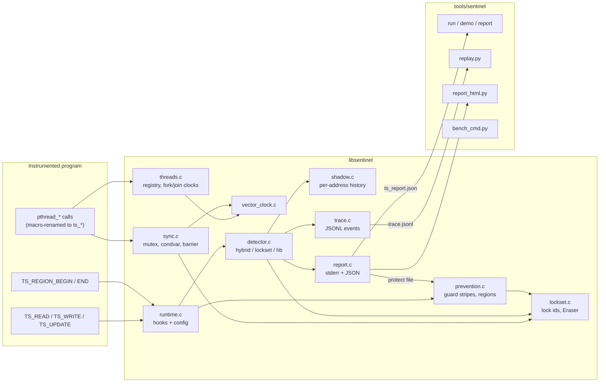

# Architecture

Thread Sentinel is a C11 runtime library (`libsentinel.a` / `.so`) plus a Python tool suite.
Programs opt in at compile time: they include `sentinel.h`, mark shared accesses with `TS_*`
macros, and link the library. The same source compiled with `-DTS_DISABLE` is the uninstrumented
baseline.

## 1. Big picture



## 2. Subsystems

| File | Responsibility | Key state |
|---|---|---|
| `include/sentinel.h` | Public API: access macros, region macros, `pthread_*` → `ts_*` renames, `TS_DISABLE` passthrough | – |
| `src/runtime.c` | Constructor/destructor, env-var config, the global runtime mutex, `ts_*_pre/post` access hooks, region entry points | `g_ts_config`, `g_ts_runtime_mutex` (recursive) |
| `src/threads.c` | Thread registry; `ts_pthread_create` wraps the start routine in a trampoline that assigns the tid and seeds the child's clocks; `ts_pthread_join` merges the child's final clocks | `g_thread_table[64]`, `__thread g_ts_current_tid` |
| `src/sync.c` | Mutex / trylock / unlock, cond signal / broadcast / wait, barrier wrappers applying the clock rules | per-object records (≤ 256 of each) holding `L_m`, `S_c`, `A_b` |
| `src/vector_clock.c` | Fixed 64-entry clocks: init, copy, increment, join, epoch compare, format | – |
| `src/lockset.c` | Lock-address → id (0..63), held-lock bitmask helpers, Eraser state machine | `g_lock_addrs[64]` |
| `src/shadow.c` | Hash table addr → shadow entry (last write, reads since, Eraser tracker, trace-compaction state) | 65,536 buckets, chained |
| `src/detector.c` | Per-access classification (Section 5 of ALGORITHMS.md), trace compaction | – |
| `src/prevention.c` | Protected set, 256 guard stripes, regions with ascending lock order, per-thread hold depth | `g_protected_items[256]`, `g_guard_stripes[256]` |
| `src/report.c` | De-duplicated race list, coloured stderr lines, JSON report at exit | `g_reported_races[1024]` |
| `src/trace.c` | Optional JSONL event log (`TS_TRACE`) with 1 MiB buffering | `g_trace_fp` |

## 3. Data flow of one access

`TS_WRITE(x, v)` expands to:

```
ts_write_pre(&x, "x")          // prevent mode: if x is protected, take its guard stripe
x = v                          // the real access, in user code
ts_write_post(&x, "x", file, line)
    lock runtime
      detector_process_access  // shadow lookup -> Eraser update -> trace -> classify
                               // -> report_record_race (+ live protect in prevent mode)
    unlock runtime
    // prevent mode: release the guard stripe if this access took it
```

The access happens *between* the hooks, so in prevent mode the guard stripe really serialises
the access itself, not just the bookkeeping.

## 4. Configuration (environment variables)

| Variable | Values | Default |
|---|---|---|
| `TS_MODE` | `detect`, `prevent`, `off` | `detect` |
| `TS_DETECTOR` | `hybrid`, `lockset`, `hb` | `hybrid` |
| `TS_REPORT` | JSON report path | `ts_report.json` |
| `TS_PROTECT_FILE` | a previous JSON report; its variables are protected from the start | none (live protection only) |
| `TS_TRACE` | JSONL trace path | none (tracing off) |
| `TS_QUIET` | `1` / `true` suppresses stderr race lines | off |

## 5. Lifecycle

1. **Start-up**: `ts_runtime_init` is an ELF constructor, so it runs before `main`. It parses the
   environment and initialises every subsystem. Main becomes tid 0 with clocks `[1]`.
2. **Run**: wrappers and hooks update clocks, locksets and shadow memory under the runtime lock.
3. **Exit**: `ts_runtime_shutdown` (an `atexit` handler and destructor, guarded to run once)
   writes the JSON report, flushes any trace records deferred by compaction, closes the trace and
   frees shadow memory.

## 6. Invariants

- **Single runtime lock.** All clock, lockset, shadow and report state is read or modified only
  while holding `g_ts_runtime_mutex` (recursive, so wrappers can nest). The one exception is
  `prevention_is_protected`, which runs in the access pre-hook without the lock: the protected
  list is published with an atomic release store of its count and read with acquire loads, and
  name→address binding uses a compare-and-swap.
- **Clock monotonicity.** A thread's own component only increases, and joins only raise
  components. Every epoch comparison relies on this.
- **ST ⊑ HB.** ST follows the same rules as HB minus mutex edges, so ST-ordered implies
  HB-ordered. This is why POTENTIAL is well-defined.
- **Lock-order safety in prevention.** Guard stripes are taken either one at a time (single access)
  or as a sorted set (regions). A thread never waits for a lower stripe while holding a higher one,
  as long as regions list every protected variable they touch.
- **No unbalanced unlocks.** A per-thread hold depth per stripe means an unlock without a matching
  lock is a no-op. This happens when an address becomes protected between the pre and post hooks.
- **Trace equivalence.** Compaction only omits accesses that cannot change a verdict (a
  same-thread run after that thread's write; identical re-reads). The deferred final records are
  flushed when another thread touches the address, on `TS_FREE`, and at exit, so the offline
  replay reaches the same race set as the runtime.

## 7. Python tools

| Command | What it does |
|---|---|
| `python -m sentinel run <bin> [--mode] [--detector] [--report] [--trace] [-- args]` | run any instrumented binary and pretty-print its report |
| `python -m sentinel demo <name> [--html out.html]` | build and run a demo |
| `python -m sentinel report <json> [--html out.html]` | print a report; optionally write a standalone HTML report with Plotly inlined |
| `python -m sentinel replay <trace.jsonl> --report <json>` | re-run the classification offline and print `MATCH` / `MISMATCH` against the C report |
| `python -m sentinel bench` | run the evaluation and regenerate `docs/EVALUATION.md` |

Run them with `PYTHONPATH=tools` from the repository root (the Makefile targets do this).

## 8. Limits and known gaps

| Limit | Value / behaviour |
|---|---|
| Threads per process lifetime | 64 including main; thread slots are not reused after join |
| Distinct mutexes / condvars / barriers | 64 lock ids (lockset bitmask); 256 records of each sync type |
| Protected variables | 256 |
| Reported unique races | 1,024 |
| Region size | 16 variables |
| Instrumentation | manual (`TS_*` macros); unannotated accesses are invisible |
| Scalability | every instrumented access takes the global runtime lock (see EVALUATION.md §3) |
| Shadow history | last write + last read per thread; an older overwritten write is forgotten |
| Condvar / barrier clocks | accumulate across signals / generations (may hide races, never invents them) |
